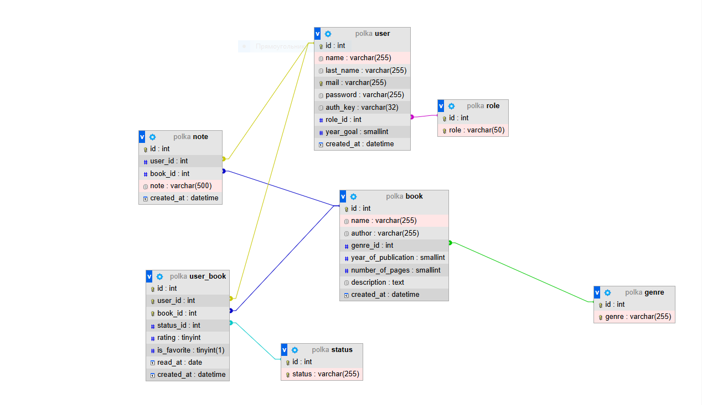
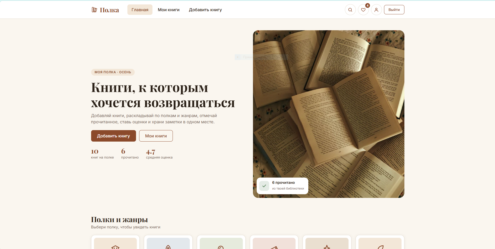
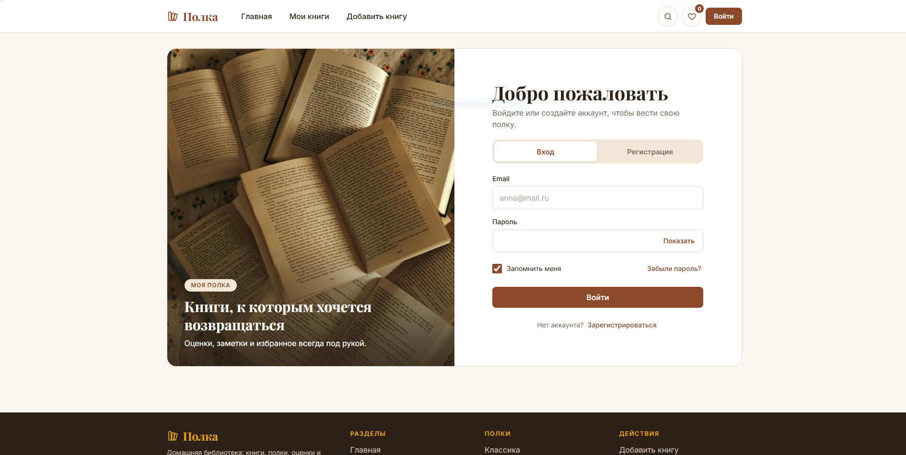
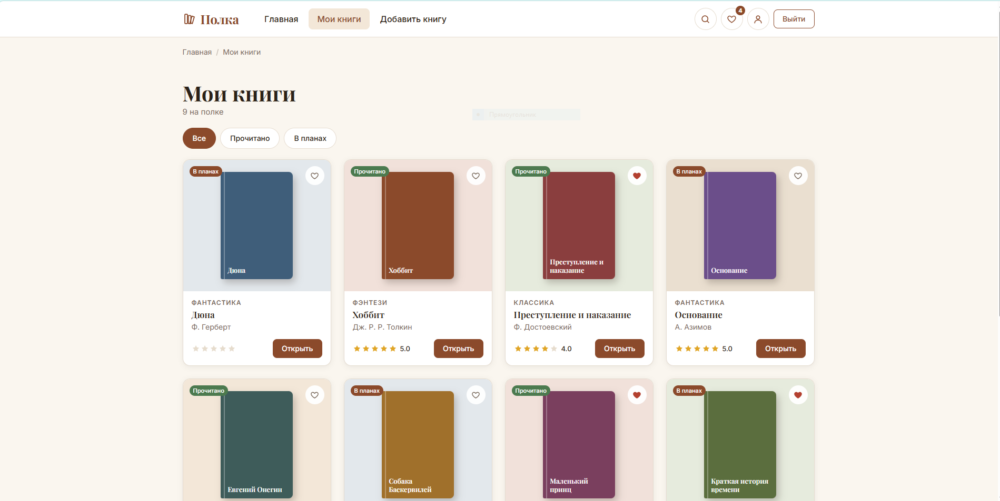
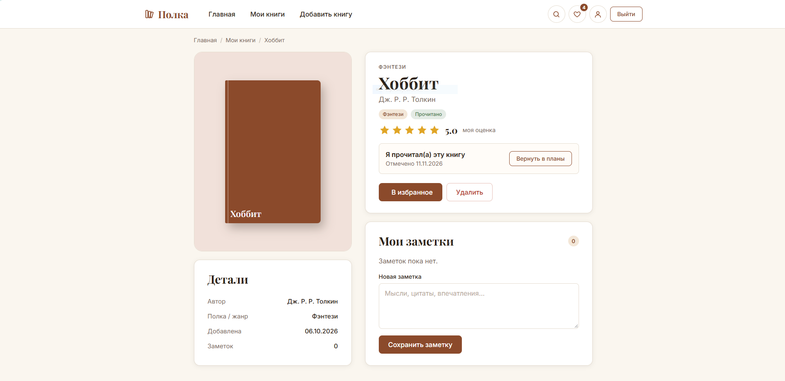
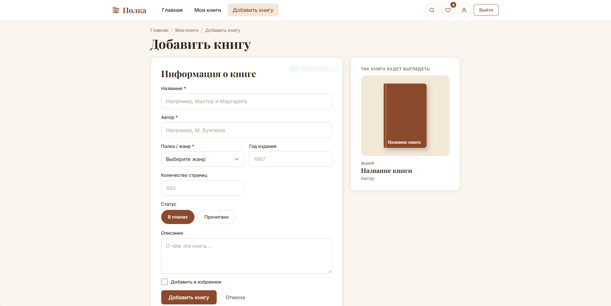
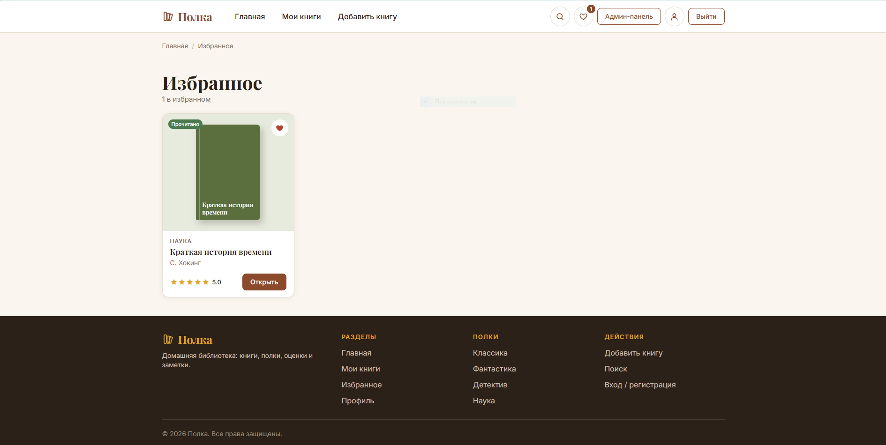
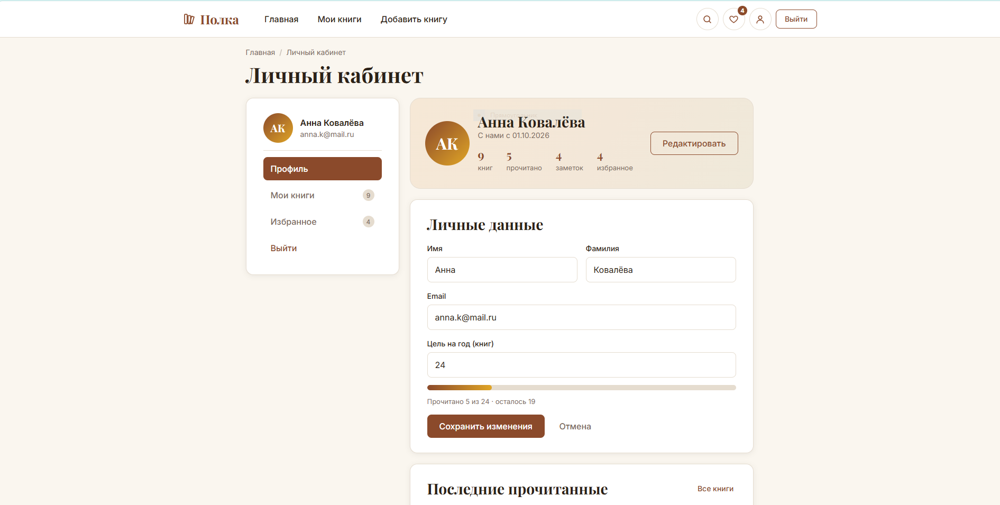
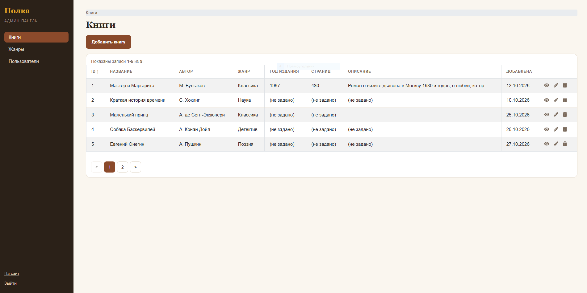

# Полка — домашняя библиотека

Учебный проект на Yii2 (basic): личная полка книг с оценками, статусами «прочитано / в планах», избранным и заметками.

## Возможности

- Регистрация, вход, выход. Роли: гость, пользователь, администратор.
- «Мои книги»: список с фильтром по статусу и постраничной навигацией.
- Страница книги: оценка 1–5, статус «прочитано», избранное, личные заметки, удаление с полки.
- Добавление книги: название, автор, жанр, год, страницы, описание, статус и оценка.
- Избранное (отдельная страница и сердечки на карточках).
- Профиль: личные данные, цель на год с прогрессом, статистика, последние прочитанные.
- Админ-панель (только роль admin): CRUD книг, жанров, пользователей, списки с сортировкой и пагинацией.

## Установка

1. Скопировать проект в папку сервера (Open Server: `domains/natyashka`).
2. Установить зависимости: `composer install`.
3. Создать пустую базу `polka` (кодировка utf8mb4) и указать доступ в `config/db.php`.
4. Создать таблицы и справочники: `yii migrate`.
   Либо импортировать готовый дамп `db/polka_dump.sql` через phpMyAdmin (вкладка «Импорт»): в нём структура и демо-данные.
5. Открыть сайт: `http://127.0.0.1/web/`.

## Тестовые аккаунты (пароль у всех `demo1234`)

| Роль | Почта |
|---|---|
| Пользователь | anna.k@mail.ru |
| Администратор | admin@polka.ru |
| Пользователь | ivan.s@mail.ru |

Админ-панель: `/web/book`, `/web/genre`, `/web/user` (только для администратора).

## База данных

Таблицы: `role`, `user`, `genre`, `status`, `book` (общий каталог), `user_book` (книга на полке пользователя: статус, оценка, избранное, дата прочтения), `note` (заметки пользователя к книге).
Связи: user → role, book → genre, user_book → user / book / status, note → user / book. Все внешние ключи заданы миграциями.

## Безопасность

- Пароли хранятся как bcrypt-хеши (`Yii::$app->security`).
- `AccessControl`: страницы пользователя только для вошедших, админ-панель только для роли admin.
- CSRF-токен во всех формах, изменения данных только методом POST (`VerbFilter`).
- Весь вывод экранируется `Html::encode`.
- Запросы через ActiveRecord, пользователь видит и меняет только свои записи (`user_id`).
- Валидация на сервере (`rules()`) и в браузере (JS).

## Структура

- `models/` — ActiveRecord-модели, формы `LoginForm`, `SignupForm`, `AddBookForm`, `ProfileForm`, поиск `BookSearch`.
- `controllers/` — `SiteController` (публичная часть), `AdminController` и CRUD-контроллеры.
- `views/` — представления; `views/layouts/main.php` и `admin.php` — макеты.
- `migrations/` — миграции схемы и справочников.
- `web/css`, `web/js`, `web/image` — стили, скрипты, изображения.

## Структура базы данных (ER-диаграмма)

## Скриншоты

| Страница | Скриншот |
|---|---|
| Главная |  |
| Вход и регистрация |  |
| Мои книги |  |
| Страница книги |  |
| Добавление книги |  |
| Избранное |  |
| Профиль |  |
| Админ-панель |  |
